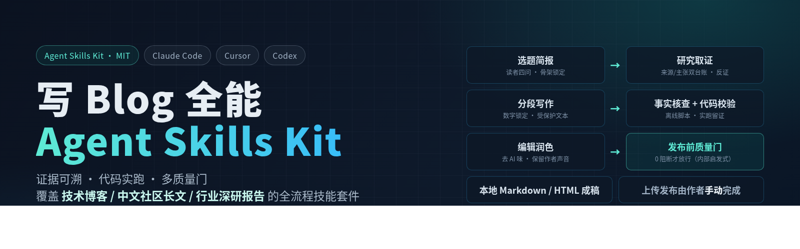
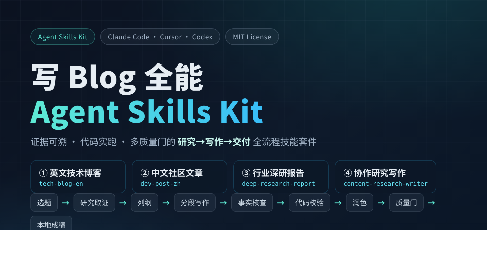
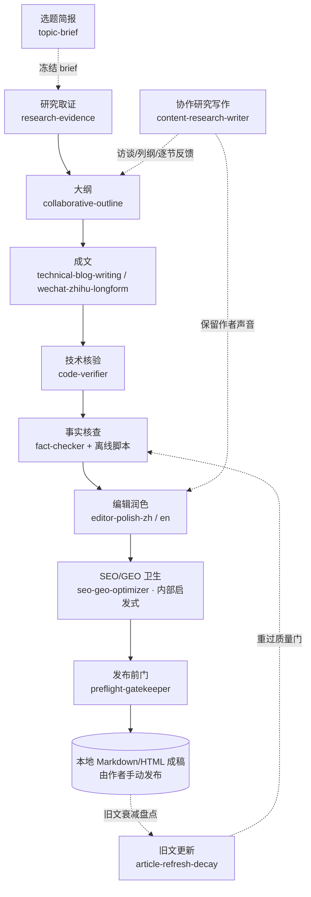

<p align="center">
  
</p>

<h1 align="center">Awesome-Blog · 写 Blog 全能 Agent Skills Kit</h1>

<p align="center">
  <b>研究可审计、数字有来源、代码真跑过 —— 一套止于本地成稿的技术写作 / 深度研究 Agent Skills。</b>
</p>

<p align="center">
  <a href="./LICENSE"></a>
  
  
  
</p>

> **English abstract.** Awesome-Blog is an open **Agent Skills** kit for producing
> in-depth technical blog posts (English / Chinese) and evidence-auditable industry
> research reports. It ships 4 independently installable entry stacks and 13 shared
> supporting skills, plus offline Python-stdlib scripts that validate frontmatter,
> evidence ledgers, claim-to-source citations, TAM/SAM/SOM math and a pre-delivery
> quality gate. Every pipeline stage has a blocking quality gate; unverified numbers
> become `[需补：…]` placeholders instead of being invented, and code is actually run.
> Any rubric score or SEO/GEO output is a **local heuristic only — no ranking or
> AI-citation results are promised**. The kit produces **local Markdown/HTML only**: it
> contains no platform login, cookie handling or auto-publishing; you publish manually.

---

## ⚡ 30 秒选技能

四个**可独立安装**的主技能，按写作目标选一个即可：

| 中文名 | slug | 适用场景 | 一键安装命令 |
| --- | --- | --- | --- |
| **英文技术博客** | `tech-blog-en` | 英文技术深度博客 / 开发者技术文章（教程、原理 deep dive、benchmark、postmortem、工程实践） | `bash scripts/install.sh tech-blog-en` |
| **中文社区文章** | `dev-post-zh` | 中文开发者社区文章、公众号深度文、知乎长文 | `bash scripts/install.sh dev-post-zh` |
| **行业深研报告** | `deep-research-report` | 科技 / 金融行业研究与产业深度研报（含 TAM/SAM/SOM 双路径测算、证据台账、反证尝试） | `bash scripts/install.sh deep-research-report` |
| **协作研究写作** | `content-research-writer` | 研究取证、协作列纲、钩子打磨、逐节反馈、保留作者声音；可被上面两个写作栈调用 | `bash scripts/install.sh content-research-writer` |

> 想一次装齐：`bash scripts/install.sh --all`。

### 手动安装（不跑脚本）

把对应技能文件夹复制到宿主的 skills 目录即可，例如：

```bash
# Claude Code
cp -R skills/tech-blog-en ~/.claude/skills/
# Cursor
cp -R skills/dev-post-zh   ~/.cursor/skills/
# Codex
cp -R skills/deep-research-report ~/.codex/skills/
```

> 注意：主栈会引用套件根目录的共享资产（`references/`、`templates/`、
> `checklists/`、`scripts/`）。手动复制单技能时，建议用安装脚本（默认 `copy`
> 模式会把共享资产一并打包进技能文件夹），或直接 `--mode link` 软链整个 clone。

---

## 目录

- [一句话价值主张](#一句话价值主张)
- [能力矩阵](#能力矩阵)
- [架构与流水线](#架构与流水线)
- [安装（三种宿主）](#安装三种宿主)
- [5 分钟快速开始](#5-分钟快速开始)
- [三个端到端工作流示例](#三个端到端工作流示例)
- [技能逐个介绍](#技能逐个介绍)
- [质量与事实核查承诺](#质量与事实核查承诺)
- [设计来源与致谢](#设计来源与致谢)
- [许可证](#许可证)
- [FAQ](#faq)

---

## 一句话价值主张

**把“会写字的 AI”变成“对证据负责的写作搭档”**：先访谈再动笔，先取证再成文，
代码真跑、数字有源、主张可追溯、反证有记录；阶段不过门就不许往下走，最终只把
**本地 Markdown/HTML 成稿**交给你，发布动作永远由你本人手动完成。

---

## 能力矩阵

场景 × 技能：✅ 主栈覆盖　🔧 由共享子技能在流程中承担　🔗 可调用横向技能

| 写作场景 | 英文技术博客 `tech-blog-en` | 中文社区文章 `dev-post-zh` | 行业深研报告 `deep-research-report` | 协作研究写作 `content-research-writer` |
| --- | :---: | :---: | :---: | :---: |
| 英文教程 / 原理 / benchmark / postmortem | ✅ | — | — | 🔗 |
| 中文公众号 / 知乎 / 社区长文 | — | ✅ | — | 🔗 |
| 行业研究 / 产业链 / 竞争格局 | — | — | ✅ | 🔗 |
| TAM/SAM/SOM 市场测算与情景敏感性 | — | — | ✅ | — |
| 选题访谈 + 多标题候选 | 🔧 | 🔧 | 🔧 | 🔗 |
| 多源取证 / 证据台账 / 反证 | 🔧 | 🔧 | 🔧 | 🔗 |
| 协作列纲（钩子/张力/论点/结尾） | 🔧 | 🔧 | 🔧 | ✅ |
| 代码实跑校验 | 🔧 | 🔧 | — | — |
| 事实核查 / claim-source 审计 | 🔧 | 🔧 | 🔧 | — |
| 中英文去 AI 味编辑润色 | 🔧 | 🔧 | 🔧 | ✅ |
| SEO/GEO 卫生检查（内部启发式） | 🔧 | 🔧 | 🔧 | — |
| 发布前门 preflight + rubric | 🔧 | 🔧 | 🔧 | — |
| 旧文衰减盘点与更新 | 🔧 | 🔧 | 🔧 | — |

---

## 架构与流水线

套件采用「**主编排栈 + 专项子技能 + 离线确定性脚本**」分层：四个入口栈编排流水线，
子技能负责单一职责，脚本只做离线、可复现的机械校验（不联网、不调模型）。



**统一阶段契约（十阶段，每阶段都有输入 / 输出契约与质量门）**：
`0 选题访谈 → 1 研究取证 → 2 追问澄清/口径锁定 → 3 骨架协作 → 4 分段写作 →
5 事实核查 → 6 技术校验 → 7 编辑润色 → 8 SEO/GEO 卫生 → 9 preflight 发布前门 →
10 本地交付`，另加可选的“旧文更新”。门结论四档：**PASS / PASS-WITH-NITS /
BLOCKED / NEEDS-HUMAN**，BLOCKED 一律禁止流向下一阶段。详见
[`references/quality-gates.md`](./references/quality-gates.md)。

---

## 安装（三种宿主）

```bash
git clone https://github.com/ZhanlinCui/Awesome-Blog.git
cd Awesome-Blog
```

安装脚本真实参数（以 `bash scripts/install.sh --help` 为准）：

```text
Usage: scripts/install.sh [options] [skill ...]

Options:
  --host claude|cursor|codex   目标宿主（默认 claude）
  --dest DIR                   显式指定 skills 目录（覆盖 --host）
  --mode copy|link             copy：复制为自包含技能（默认）；link：软链整个仓库
  --all                        安装全部技能（不带参数时的默认行为）
  -h, --help                   查看帮助
```

| 宿主 | 默认 skills 目录（不存在会自动创建） | 示例 |
| --- | --- | --- |
| **Claude Code** | `~/.claude/skills` | `bash scripts/install.sh tech-blog-en` |
| **Cursor** | `~/.cursor/skills` | `bash scripts/install.sh --host cursor dev-post-zh` |
| **Codex** | `~/.codex/skills` | `bash scripts/install.sh --host codex deep-research-report` |

两种安装模式：

- **`copy`（默认）**：每个被选技能复制成**自包含文件夹**，共享的
  `references/`、`templates/`、`checklists/`、`scripts/` 会一并打包进技能内部，
  并改写内部相对路径，单个文件夹即可独立使用、可直接分享给同事。
- **`link`**：把仓库里的技能文件夹**软链**到宿主目录，共享资产仍指向 clone，
  适合参与本套件开发：`bash scripts/install.sh --mode link --all`。

装完后重启 / reload 宿主，让它重新扫描 skills 目录。

---

## 5 分钟快速开始

1. **装一个栈**（以英文技术博客 + Claude Code 为例）：
   ```bash
   bash scripts/install.sh tech-blog-en
   ```
2. **建工作目录并在其中打开宿主**：
   ```bash
   mkdir -p ~/writing/build-time-post && cd ~/writing/build-time-post
   # 在该目录启动 Claude Code（或 Cursor / Codex）
   ```
3. **用一句话提需求，让技能先走访谈**：
   ```text
   用「英文技术博客」帮我写一篇：我们如何把 CI 构建时间从 12 分钟降到 90 秒。先别写正文，先问我问题。
   ```
4. 技能会依次产出：`01_brief.md` 与 10 个标题候选 → 研究三件套
   （`task_spec.md`、`source_registry.csv`、`claims_registry.csv`）→ 锁定的
   `outline.md` → 逐节草稿 → `verification_log.md`（代码实跑）→ 事实核查与润色 →
   preflight 0 阻断 → `deliverables/final.md`。
5. **拿到本地成稿后，由你自己登录目标平台手动发布**（套件不含任何上传能力）。

> 想先单独体验“协作研究 + 列纲 + 逐节反馈”：`bash scripts/install.sh content-research-writer`，
> 然后说“用**协作研究写作**帮我写一篇关于 X 的文章，先别动笔，先问我问题”。

---

## 三个端到端工作流示例

### 示例 1 · 一篇英文技术 Blog（tech-blog-en）

> 选题：*How we cut CI build time from 12 minutes to 90 seconds*

1. **Intake 访谈**：读者是中型团队的平台工程师；产出 `01_brief.md`，
   给出 10 个不同角度的英文标题候选，作者选定后冻结。BRIEF GATE 通过。
2. **研究取证**：构建缓存原理、Bazel/remote cache、CI 定价口径等全部进入
   来源登记册；版本号、弃用声明记录检索日期。
3. **骨架**：Problem → Baseline（真实测量）→ Changes（每条独立可回滚）→
   Benchmark（环境/配置/重复次数/原始结果）→ Lessons，作者锁定。
4. **成文 + 代码校验**：所有命令在一次性环境实跑，输出逐字比对，记入
   `verification_log.md`；性能数字带硬件/日期/统计方式，可复现。
5. **Fact-check → 英文润色 → SEO/GEO → preflight**：无虚构数字、受保护文本
   （命令/参数/版本号）未被润色改动，rubric 附扣分项，0 阻断。
6. **交付** `deliverables/final.md`（可选 HTML）。作者自行发布到工程博客。

### 示例 2 · 一篇中文公众号深度文（dev-post-zh）

> 选题：给业务工程师讲明白“向量检索为什么会召回不准”

1. 访谈锁定读者（用过 RAG 但没调过召回的后端）与阅读场景（手机端通勤读），
   标题给信息型/反差型候选，拒绝“震惊/必看/万字干货”。
2. 研究后做**追问澄清（Question Loop）**：哪些结论与作者踩坑经验冲突、
   哪些一线案例只有作者能提供，补进 brief 与台账。
3. 前 3 行用具体问题留人；术语首次出现给一句大白话，但 `embedding`、API、
   库名保留英文原名，不硬翻、不做无必要中英夹杂。
4. 多角色审核循环：**事实核查员 → 技术审校（Blocker/Major/Minor/Nit）→
   中文编辑（去 AI 腔，只给选项作者拍板）**。
5. 按 [`references/platform-adaptation.md`](./references/platform-adaptation.md)
   生成短段、小标题、真实 Mermaid 配图的 `deliverables/wechat-final.md`；
   没有 `[图X]` 占位。
6. preflight 特别检查“无平台发布相关代码/指令”后交付，**作者自己登录公众号粘贴**。

### 示例 3 · 一篇行业研报（deep-research-report）

> 选题：某 AI 基础设施细分市场的规模与竞争格局

1. **研究契约**：在 `task_spec.md` 锁定口径（指标定义、单位、币种、基期、
   名义/实际、存量/流量）与检索截止日期。口径不锁，一切测算 BLOCKED。
2. **系统取证**：官方统计 / 监管文件 > 公司公告财报 > 透明方法的研究 > 媒体；
   沿 `original_producer` 回溯原始生产者，聚合转载不算第二来源；利益相关来源显式标注。
3. **主张—证据—反证台账**：关键主张主动做反向检索并记录结果；争议数字以
   区间 / “不同机构分歧”呈现，不二选一伪装确定值。
4. **市场测算**：填 `market_assumptions.csv`，TAM/SAM/SOM 同时走自上而下与
   自下而上两条路径并**对账**（默认差异阈值 ±20%），给 bear/base/bull 三情景与
   单变量敏感性；全部由离线脚本确定性复算：
   ```bash
   python3 scripts/market_sizing.py --assumptions market_assumptions.csv \
     --reconcile-tolerance 0.20 --sensitivity GROWTH_base:0.08:0.12:0.18
   ```
5. 成稿含“反方观点与不确定性”节；审计脚本核对每个正文数字都能在台账找到；
   结论强度与证据匹配（估算不写成事实、相关不写成因果）。
6. preflight 0 阻断并**剥离 S0xx/C0xx 内部 ID 与审计标签**，交付
   `deliverables/report-final.md`。报告不构成投资 / 法律 / 税务建议。

---

## 技能逐个介绍

### 四个可独立安装的入口

| 技能 | 许可证 | 职责 |
| --- | --- | --- |
| [`tech-blog-en`](./skills/tech-blog-en/SKILL.md) | MIT | 英文技术深度博客全流程栈，编排下述子技能并内置多阶段质量门。 |
| [`dev-post-zh`](./skills/dev-post-zh/SKILL.md) | MIT | 中文社区 / 公众号 / 知乎长文栈，含研究后追问澄清与多角色审核循环。 |
| [`deep-research-report`](./skills/deep-research-report/SKILL.md) | MIT | 科技 / 金融 / 产业深研栈，证据双台账、反证、TAM/SAM/SOM 双路径对账。 |
| [`content-research-writer`](./skills/content-research-writer/SKILL.md) | **Apache-2.0**（© ComposioHQ，经适配） | 横向协作技能：研究、列纲、钩子、逐节反馈，保留作者声音；可被三个栈调用。 |

### 12 个共享子技能（被各栈引用）

| 技能 | 一句话职责 |
| --- | --- |
| [`topic-brief`](./skills/topic-brief/SKILL.md) | 选题简报：访谈式 intake、读者画像四问、核心论点、≥10 个标题候选。 |
| [`research-evidence`](./skills/research-evidence/SKILL.md) | 研究取证：建来源/主张双台账，多源交叉验证、独立印证判定、反证、口径登记。 |
| [`collaborative-outline`](./skills/collaborative-outline/SKILL.md) | 协作列纲：钩子/张力/核心论点/结尾路径四件套，逐节标注证据状态，作者锁定。 |
| [`technical-blog-writing`](./skills/technical-blog-writing/SKILL.md) | 技术成文：数字锁定、受保护文本、可运行代码块、benchmark/postmortem 结构。 |
| [`wechat-zhihu-longform`](./skills/wechat-zhihu-longform/SKILL.md) | 中文长文成稿：前 3 行钩子、短段节奏、术语成人话、纯中文纪律、评论区预演。 |
| [`fact-checker`](./skills/fact-checker/SKILL.md) | 事实核查：claim-source 审计、数字口径、独立印证、反证复核、研究痕迹剥离。 |
| [`code-verifier`](./skills/code-verifier/SKILL.md) | 代码校验：隔离环境实跑、benchmark 复现、无法运行时强制显式标注。 |
| [`editor-polish-zh`](./skills/editor-polish-zh/SKILL.md) | 中文润色：去 AI 腔（套话排比、空泛升华、翻译腔、中英夹杂），诊断+处方。 |
| [`editor-polish-en`](./skills/editor-polish-en/SKILL.md) | 英文润色：generic-AI-prose 清单、节奏与术语一致性，保留非母语作者真实声音。 |
| [`seo-geo-optimizer`](./skills/seo-geo-optimizer/SKILL.md) | SEO/GEO 页面卫生与问答友好度检查（纯内部启发式，不承诺排名 / 引用效果）。 |
| [`preflight-gatekeeper`](./skills/preflight-gatekeeper/SKILL.md) | 发布前门：跑离线 preflight、清单核查、rubric 放行裁决、研究痕迹终扫。 |
| [`article-refresh-decay`](./skills/article-refresh-decay/SKILL.md) | 旧文更新：六类衰减信号盘点，变化项重新取证并重过质量门，诚实披露勘误。 |

另有一个**索引/编排契约**技能 [`blogkit-assets`](./skills/blogkit-assets/SKILL.md)
（非必装入口），描述套件全貌、中文名路由与共享资产地图。

### 共享资产

- **规范 [`references/`](./references/)**：[质量门总则](./references/quality-gates.md)、
  [证据台账规范](./references/evidence-ledger-spec.md)、
  [平台内容适配（仅本地排版）](./references/platform-adaptation.md)、
  [旧文更新与衰减](./references/refresh-and-decay.md)。
- **模板 [`templates/`](./templates/)**：article_brief、task_spec、
  source_registry / claims_registry / market_assumptions 三个 CSV、outline、rubric。
- **清单 [`checklists/`](./checklists/)**：factcheck_checklist、preflight_checklist。
- **离线脚本 [`scripts/`](./scripts/)**（仅 Python 标准库，不联网、不调模型）：
  - `validate_frontmatter.py`：校验所有 SKILL.md frontmatter；
  - `validate_evidence_ledger.py`：来源/主张台账完整性；
  - `audit_claim_citations.py`：成稿 claim 引用审计与研究痕迹检查；
  - `market_sizing.py`：TAM/SAM/SOM 双路径对账、三情景与敏感性；
  - `preflight.py`：交付前本地稿件检查；
  - `check_local_links.py`：Markdown 相对链接 / 图片是否存在；
  - `install.sh`：多宿主安装；`tests/`：9 组功能测试与 good/bad fixtures。

### 目录结构

```text
Awesome-Blog/
├── assets/                 # 封面图（cover-banner.png / cover-16x9.png）
├── checklists/             # 事实核查与 preflight 清单
├── references/             # 质量门 / 证据台账 / 平台适配 / 衰减规范
├── scripts/                # 离线校验脚本 + install.sh + tests/
├── skills/                 # 4 个入口 + 12 个共享子技能 + 1 个编排索引
│   └── content-research-writer/   # Apache-2.0，目录内自带 LICENSE 与 references/
├── templates/              # brief / task_spec / 三个 CSV / outline / rubric
├── ATTRIBUTION.md          # 设计来源、许可证清单与致谢
├── NOTICE.md               # 许可与免责声明
├── LICENSE                 # MIT（套件原创内容）
└── README.md
```

---

## 质量与事实核查承诺

- **阶段不过门，产物不向下游流动**。每阶段有可阻断（BLOCKED）的质量门；
  机器判不了的走 NEEDS-HUMAN，由作者显式决策。
- **数字锁定**：没有来源的具体数字一律写成 `[需补：数字及来源]`，绝不编造；
  代码 / 命令 / API 名 / 参数 / 版本号是受保护文本，润色不得擅改。
- **代码真跑过**：代码块在隔离环境实际运行并记录环境、命令、输出、退出码；
  无法运行必须显式标注“未经运行验证”及原因，不能假装已验证。
- **证据可审计**：关键事实要求独立印证（沿原始生产者回溯，聚合转载不算第二来源），
  关键主张主动做反证尝试；争议数字以区间呈现。
- **评分为内部启发式，不构成效果承诺**：任何百分制 rubric 分数、分级意见或
  SEO/GEO 检查结论，都只是**本地内部**用于发现问题、改稿前后对比与放行裁决的
  启发式检查，**不构成对搜索引擎排名、推荐 / 引用流量或任何商业结果的承诺或保证**。
  `market_sizing.py` 仅对你自己提供的假设做确定性算术核算，**不构成投资、法律、
  税务或监管建议**。
- **只生产本地成稿，发布一律手动**：套件产物只有本地 Markdown/HTML。
  套件**不含**任何平台登录、Cookie / 凭据处理、模拟登录或自动发布能力，
  preflight 甚至会把这类实现内容当作**阻断项**拦截。是否、何时、发布到哪个平台，
  全部由你本人手动完成。

### 自检（本仓库随附）

```bash
python3 scripts/validate_frontmatter.py      # 所有 SKILL.md frontmatter 合法
python3 scripts/check_local_links.py         # 仓库 Markdown 相对路径全部存在
python3 scripts/tests/run_all_tests.py       # 9 组功能测试
```

---

## 设计来源与致谢

本套件原创内容以 MIT 发布；设计过程中参考了多个开源项目的**流程思路与结构约定**，
除 `content-research-writer`（Apache-2.0，© ComposioHQ，经适配并在目录内附
LICENSE）外，**未复制任何第三方代码、原文或示例文本**，工作流描述均为原创重写。

完整清单（含许可证、借鉴点、仅作灵感参考的限制性许可项目与明确排除项）见
[**ATTRIBUTION.md**](./ATTRIBUTION.md) 与 [**NOTICE.md**](./NOTICE.md)。许可处理原则：

- **MIT / Apache 等宽松许可项目**：在 ATTRIBUTION 中署名致谢，借鉴其架构 / 流程
  思路，文案与脚本均原创；`content-research-writer` 作为 Apache-2.0 适配副本，
  保留其自带 LICENSE 与版权声明。
- **CC BY-NC(-SA) / CC BY 等限制性许可项目**：**仅阅读其公开结构以理解产品形态**，
  没有复制任何句子、段落、模板或示例，相关技能全部文字原创撰写。
- **第三方商标**：Claude Code、Cursor、Codex、GitHub、知乎、微信公众号、CSDN、
  掘金等为各自权利人商标，本套件与其无隶属、授权或背书关系。

---

## 许可证

- 本套件**全部原创内容**（除特别标注外的 SKILL.md、references/、templates/、
  checklists/、scripts/）以 **[MIT License](./LICENSE)** 发布，
  Copyright © 2026 ZhanlinCui。
- `skills/content-research-writer/` 是基于 ComposioHQ/awesome-claude-skills
  **Apache License 2.0** 内容的适配副本，沿用该目录下的
  [LICENSE](./skills/content-research-writer/LICENSE)；修改点见其 SKILL.md 顶部声明。
- 你检索得到的外部网页 / 报告 / 数据，著作权与许可归原权利人所有，请在证据台账中
  记录来源并合法合规引用。

---

## FAQ

**Q：装好之后怎么触发技能？**
A：重启宿主让它扫描 skills 目录，然后用自然语言提需求即可。中文名和 slug 都能路由：
例如“用**英文技术博客**写一篇……”“用**中文社区文章**写公众号稿”“写一份
**行业深研报告**”“用**协作研究写作**先帮我列大纲”。

**Q：必须四个主技能都装吗？**
A：不必。按目标装其中一个即可；三个写作栈会在流程中引用共享子技能，建议直接用
`install.sh`（默认 copy 会把共享资产打包进技能文件夹）。只想体验协作写作就单装
`content-research-writer`。

**Q：它会帮我自动发到公众号 / 知乎 / 掘金吗？**
A：**不会，也不打算做。** 套件只产出本地 Markdown/HTML，没有任何平台登录、
Cookie / 凭据或自动发布模块；preflight 还会拦截这类内容。发布由你本人手动完成。
平台相关的只有“按该平台读者阅读习惯调整本地排版”。

**Q：rubric 分数高，是不是就能上首页 / 被 AI 引用？**
A：不是。分数与 SEO/GEO 结论都是**本地内部启发式检查**，只用于发现问题和改稿前后
对比，不预测、不承诺任何排名、推荐量或生成式引用效果。

**Q：脚本会联网或调用模型吗？**
A：不会。`scripts/` 下的校验 / 测算脚本全部只用 Python 标准库、离线运行；
检索动作由宿主自身联网能力、你自配的研究工具或手工检索完成，其产出仍要进来源
登记册接受核查，不享受“免检”。

**Q：能保证文章里的数字都对吗？**
A：套件不替你创造事实，而是强制“每个数字有来源或复算、关键事实有独立印证、
查不到就留 `[需补：…]` 占位”。它显著降低编造与口径错误，但最终事实责任仍在作者。

**Q：可以把某个技能文件夹直接发给同事吗？**
A：可以。用默认 `copy` 模式安装得到的是自包含文件夹（共享资产已打包进去）。
`content-research-writer` 文件夹内含 Apache-2.0 LICENSE，转发时请保留。

**Q：旧文章还能维护吗？**
A：能。用 `article-refresh-decay` 做数据 / 版本 / 政策 / 格局 / 链接 / 结论六类
衰减盘点，变化项重新取证、重过质量门，并在文首“更新说明”诚实披露修正。
