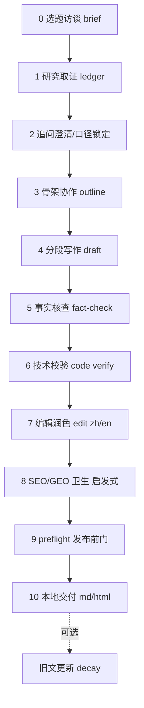

# 套件总编排索引（blogkit-assets）

> **名称对照**：中文名「套件总编排」⇄ 机器名 `blogkit-assets`。
> 本技能是**索引/编排契约**，不是必须安装的入口；日常使用直接装三个栈技能之一即可。

## 中文名 ⇄ 机器名速查

| 中文名 | 机器 slug | 定位 | 可独立安装 |
| --- | --- | --- | --- |
| 英文技术博客 | `tech-blog-en` | 英文技术深度博客全流程栈 | 是 |
| 中文社区文章 | `dev-post-zh` | 中文社区/公众号/知乎长文栈 | 是 |
| 行业深研报告 | `deep-research-report` | 科技/金融/产业深研与市场测算栈 | 是 |
| 协作研究写作 | `content-research-writer` | 协作式研究/列纲/钩子/逐节反馈横向技能（Apache-2.0，© ComposioHQ，经适配） | 是 |

共享子技能（被各栈引用）：`topic-brief`、`research-evidence`、`collaborative-outline`、
`technical-blog-writing`、`wechat-zhihu-longform`、`fact-checker`、`code-verifier`、
`editor-polish-zh`、`editor-polish-en`、`seo-geo-optimizer`、`preflight-gatekeeper`、
`article-refresh-decay`。

## 路由规则

1. 英文技术深度文 → `tech-blog-en`；
2. 中文技术社区/公众号/知乎长文 → `dev-post-zh`；
3. 行业研究/市场测算/Deep Research → `deep-research-report`；
4. 用户只要“陪我一起研究+列纲+逐节改、保留我的风格” → `content-research-writer`；
5. 任务跨类型时，由对应主栈在内部调用共享子技能与横向技能。

## 统一阶段契约（十个阶段）

- 每阶段有**输入契约**（上一阶段产物）、**输出契约**（本阶段落盘文件）、**质量门**
  （见 `../../references/quality-gates.md`）。
- 门结论四档：PASS / PASS-WITH-NITS / BLOCKED / NEEDS-HUMAN；BLOCKED 禁止下流。
- 所有评分为内部启发式，不构成排名、引用、流量等任何商业效果承诺。
- 流水线**止于本地成稿**；任何平台登录/上传/发布都不在套件范围内。

## 共享资产地图

- 规范：`../../references/quality-gates.md`、`evidence-ledger-spec.md`、
  `platform-adaptation.md`、`refresh-and-decay.md`
- 模板：`../../templates/`（brief、task_spec、source/claims/market 三个 CSV、outline、rubric）
- 清单：`../../checklists/preflight_checklist.md`、`factcheck_checklist.md`
- 离线脚本（Python 标准库，不联网、不调模型）：`../../scripts/`
- 安装：`../../scripts/install.sh`

## 边界

- 不生成虚构来源与数字；不跳过质量门；不处理平台凭据；不提供投资等持牌建议。
